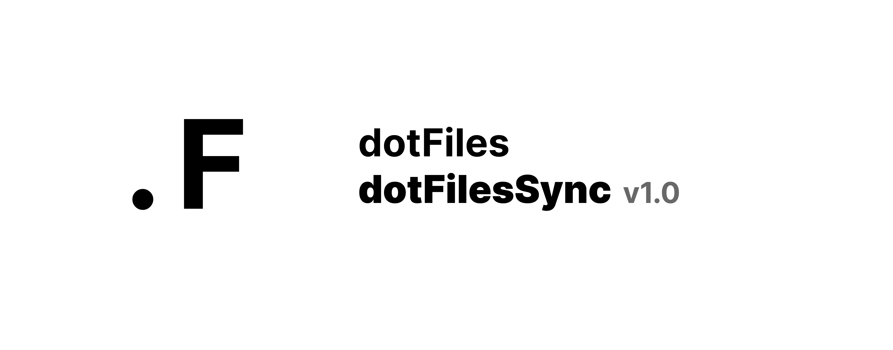

# My dotfiles Setup



Feel free to use or adapt for personal use.

```bash
git clone git@github.com:ramseylourens/dotfiles.git ~/Library/Mobile\ Documents/com~apple~CloudDocs/dotfiles/
cd ~/Library/Mobile\ Documents/com~apple~CloudDocs/dotfiles/
./setup.sh
```

`./setup.sh --dry-run` prints what would be installed without changing anything.
`./setup.sh --install-sync-app` builds and installs the desktop app for macOS or Linux. On Windows, run `.\setup.ps1` in PowerShell from the repository root.

The desktop app source is in [apps/DotfilesSync/desktop](./apps/DotfilesSync/desktop). Mobile iOS and Android targets are not part of this desktop build. macOS uses the React Native macOS target; Linux and Windows use the Electron shell around the shared web UI. The app's Settings screen lets you switch between a regular Dock/taskbar window and a menu-bar/system-tray mode. The tray mode keeps the app running when its window is closed.

Build prerequisites:
- macOS: Node.js 22+, Yarn 1.22+, Xcode, and CocoaPods.
- Linux: Node.js 22+, Yarn 1.22+, and the native libraries required by Electron.
- Windows: Node.js 22+, Yarn 1.22+, and PowerShell; run the build on Windows to produce the portable app and Start Menu shortcut.

Hourly background sync and its Git commit/push policy are not yet connected to this React Native desktop app.

Open `apps/DotfilesSync/desktop/macos/ReactNativeStarter.xcodeproj` in Xcode to develop the macOS app.

## Supported machines

The package manager is detected per machine in `helpers/platform.zsh` and exported as `DOTFILES_PM` and `PKG_PREFIX`.
Set `DOTFILES_PM=brew` or `DOTFILES_PM=port` to force one.

| Machine | Package manager | Package list |
|---|---|---|
| Apple Silicon / supported Intel Macs | Homebrew | `config/Brewfile` |
| MacBook Pro 15" 2015 (`MacBookPro11,*`, OpenCore Legacy Patcher) | MacPorts | `config/macports.txt`, `config/vscode-extensions.txt` |

`dotfiles sync`, `dotfiles install` and `dotfiles upgrade` follow the detected package manager.

### MacPorts notes
- Casks and Mac App Store apps (Chrome, iTerm2, VS Code, Docker Desktop, ...) are not in MacPorts, install them manually.
- Composer and CocoaPods are installed by `setup.sh` outside MacPorts. Heroku, mongosh and corepack come from the npm globals.
- Laravel Valet needs Homebrew, so on MacPorts sites are served by nginx from `/opt/local/etc/nginx`.
- Switch PHP with `phpv 8.4`, which runs `port select --set php php84`.
- Run `helpers/ports-check.sh` to verify every port in `config/macports.txt` exists.
- After a macOS or OpenCore patch update, rebuild broken ports with `sudo port -f rebuild <port>`.
- Server ports (`mysql8-server`, `postgresql14-server`, `mongodb`) need a one-time database init, then start them with `svc start <name>`.


# Roadmap
Slow and steady

*Started January 2026*
- OSX Setup
    - [x] Xcode CLI Tools
    - [x] Homebrew Install
 
*27 Oktober 2026*
- OSX Setup
    - [x] Brewfile targetted
    - [x] First run xcode command line tools install should pause the installer

*4 November 2026*
- Intel MacBook Pro 2015 (OCLP)
    - [x] Per machine package manager detection (Homebrew / MacPorts)
    - [x] MacPorts package list and `dotfiles sync|install|upgrade` support
    - [x] `setup.sh --dry-run`
    - [x] Added Dotfilessync app

# Todo
- Dotfiles function
  A way for managing your dotfiles right within your terminal
  - [ ] ..
